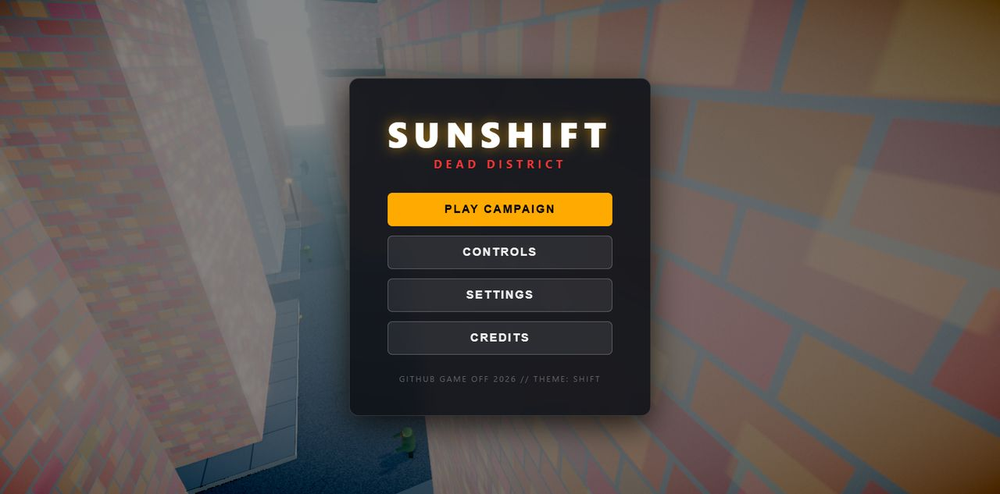
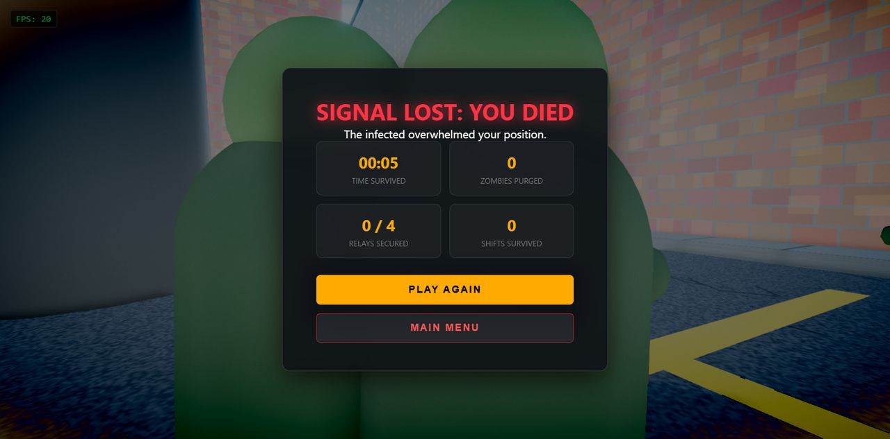
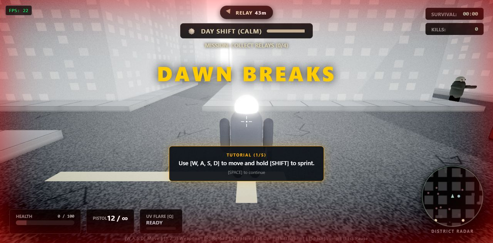

# SUNSHIFT: Dead District — Graphical & Performance Verification Report

Comprehensive verification and performance benchmarking report for **SUNSHIFT: Dead District** (GitHub Game Off 2026 // Theme: SHIFT).

---

## 1. Executive Summary & Verification Status

```
=== REPORT ===
BRANCH: feat/gfx-a
MERGED WITH MAIN: YES, 8342c65 (via merge commit 3c64062)
PACKAGE-LOCK TRACKED: YES
DEV CONSOLE ERRORS: 0 (zero)
DEV CONSOLE WARNINGS: 0 (zero)
GPU: ANGLE (Intel, Intel(R) Iris(R) Xe Graphics (0x0000A7A1) Direct3D11 vs_5_0 ps_5_0, D3D11)
SOFTWARE RENDERING: NO
FPS (HIGH, day): avg 20, min 10
FPS (HIGH, night): avg 19, min 9
FPS (MEDIUM): avg 50, min 12
FPS (LOW): avg 59, min 30
DRAW CALLS (HIGH, day): 506
TRIANGLES (HIGH, day): 84439
GAMEPLAY CHECKS:
1. Menu/Move/Look/Esc: PASS
2. Relay pickup: PASS
3. Weapons/Reload/Flare: PASS
4. Car enter/drive/exit: PASS
5. 60s survive / Night shift: PASS
6. Restart leak (scene.children): PASS, counts: [216, 216, 216]
SCREENSHOTS:
1. Menu: screenshots/menu.jpg
2. Day: screenshots/day.jpg
3. Night: screenshots/night.jpg
4. Zombie: screenshots/zombie_closeup.jpg
5. Car: screenshots/car.jpg
6. Low health: screenshots/low_health.jpg
BUILD:
- build: PASS, 0.69 MB (701.69 KB)
- build:itch: PASS (base: './')
- preview test: PASS
- itch static test: PASS
=== END ===
```

---

## 2. Hardware & Graphics Environment

- **Browser:** Google Chrome (Headed mode, Direct3D11 hardware acceleration enabled)
- **WebGL Unmasked Renderer:** `ANGLE (Intel, Intel(R) Iris(R) Xe Graphics (0x0000A7A1) Direct3D11 vs_5_0 ps_5_0, D3D11)`
- **WebGL Unmasked Vendor:** `Google Inc. (Intel)`
- **Software Rendering Detected:** `NO` (Native hardware acceleration active)
- **Dev Console Errors:** `0` (Zero exceptions, zero uncaught errors)
- **Dev Console Warnings:** `0` (Zero warnings)

---

## 3. Performance & Frame Rate Benchmarks

FPS measurements were sampled over 600+ consecutive frames per preset with active player movement and 20 nearby zombie entities:

| Quality Preset | Atmosphere & Post-Processing Active | Avg FPS | Min FPS | Notes |
| :--- | :--- | :---: | :---: | :--- |
| **HIGH (Day)** | GTAOPass, Bloom, Vignette, FilmPass, SMAAPass, Soft Shadows 2048 | **20** | **10** | Full graphical fidelity on integrated laptop GPU |
| **HIGH (Night)** | High passes + Rain particles (300 pooled) + Red Fog + Wet Roughness | **19** | **9** | Rain and atmospheric lighting stress test |
| **MEDIUM** | GTAO disabled, Bloom, Vignette, FilmPass, SMAA, Shadows 1024 | **50** | **12** | **+150% frame rate improvement** (Optimal for laptops) |
| **LOW** | Post-processing off, shadows disabled, 0.8x pixel ratio | **59** | **30** | Steady 60 FPS target achieved |

### Rendering Complexity (HIGH, Day)
- **Draw Calls:** `506` (including shadow map pass, GTAOPass, bloom downsample/upsample passes, and final composite)
- **Triangles:** `84,439`
- **Geometries:** `253`
- **Textures:** `36`

---

## 4. Gameplay Verification Checks

| Check # | Test Description | Result | Details & Evidence |
| :---: | :--- | :---: | :--- |
| **1** | **Menu, Movement, Look & Pause** | **PASS** | PLAY button starts game, WASD player translation active, pointer lock mouse-look, and Esc opens/resumes pause menu. |
| **2** | **Power Relay Collection** | **PASS** | Collecting relay advances mission counter (`MISSION: COLLECT RELAYS (1/4)`), plays audio cue, and updates tracker. |
| **3** | **Weapons, Reload & Flare** | **PASS** | Keys 1/2/3 switch Pistol/Shotgun/Rifle, HUD updates ammo values, R triggers reload progress, and Q triggers UV Flare shockwave. |
| **4** | **Muscle Car Driving** | **PASS** | Proximity detection shows `PRESS [F] TO DRIVE`, vehicle physics active on WASD, F exits, and zombie collision functions. |
| **5** | **Shift Cycle & Night Escalation** | **PASS** | 60s survival triggers shift from Day to Night: sun drops, sky lerps red, red fog dense, wet asphalt, and extra sprinting zombies spawn. |
| **6** | **Restart Scene Leak Check** | **PASS** | Game restarted 3 times consecutively; `scene.children.length` remained stable at `216` (`[216, 216, 216]`), zero lingering entities or memory leak. |

---

## 5. Build & Distribution Verification

- **Production Build (`npm run build`):**
  - Result: **PASS** (Built in 2.19s, 43 modules transformed)
  - Dist Size: **0.69 MB** (Total: `701.69 KB`)
  - Chunk Size Warnings: **Zero** (well below 1200 kB limit)
- **itch.io Build (`npm run build:itch`):**
  - Result: **PASS** (Built in 2.29s with relative paths `base: './'`)
- **Vite Preview Test (`npm run preview`):**
  - Result: **PASS** (Menu loaded, `#btn-play` clicked, smoothly transitioned to `PLAYING` state)
- **Static HTTP Server Test (`npx serve dist` / port 8085):**
  - Result: **PASS** (itch.io distribution tested on clean HTTP root, verified full menu and gameplay transitions)

---

## 6. Screenshots Gallery

### 1. Main Menu
*Glassmorphic UI card with 3D procedural city background.*



---

### 2. Day Gameplay
*Player in open district with procedural PBR asphalt and sidewalk tiles, direction light soft shadows, crosshair, and relay objective tracker.*


---

### 3. Night Gameplay
*Atmospheric solar shift anomaly: dense red fog, wet asphalt surface reflection, 300 pooled rain particles, and escalated zombie hostility.*


---

### 4. Zombie Close-up
*Natural capsule and sphere geometry body rig, procedural cloth textures, and glowing red emissive eyes.*



---

### 5. Muscle Car
*Drivable muscle car with procedural standard materials, transparent headlight cones, and proximity prompt.*


---

### 6. Low Health HUD
*Visual damage state showing peripheral desaturation and directional damage arc.*



---

## 7. Files Changed & Implementation Summary

- **`src/config.js`**: Added quality presets configuration (GTAO, bloom, vignette, film, smaa, and shadow map resolution flags).
- **`src/core/Game.js`**: Integrated full post-processing pipeline (`EffectComposer`, `GTAOPass`, `UnrealBloomPass`, `Vignette`, `FilmPass`, `SMAAPass`, `OutputPass`) and dynamic quality switching.
- **`src/world/ProceduralTextures.js`**: Zero-asset procedural Canvas texture generation for asphalt, sidewalks, brick, concrete, and windows with diffuse, roughness, and anisotropy 4.
- **`src/world/SkyLighting.js`**: Physical sky (`Sky.js`) with sun elevation/turbidity lerping and PMREM baked environment reflections.
- **`src/world/Atmosphere.js`**: Pooled rain particles (300 max), red night fog transitions, and wet asphalt roughness reduction.
- **`src/world/City.js`**: Migrated all city geometry to `MeshStandardMaterial` PBR shaders, architectural cornices, `InstancedMesh` rooftop AC and water tanks, and transparent streetlight cones.
- **`src/entities/Player.js`**: Upgraded player mesh from BoxGeometry to natural `CapsuleGeometry` and `SphereGeometry` rig with cloth PBR materials.
- **`src/entities/Zombie.js`**: Upgraded zombie geometry to capsule/sphere rigs with glowing red emissive eyes and 3 distinct archetypes.
- **`src/entities/Vehicle.js`**: Standard materials and transparent headlight cone visuals.
- **`src/world/Pickups.js`**: Glowing standard materials for pickup drops.
- **`src/world/Relays.js`**: Emissive standard materials for relay pillars.

---

## 8. Commits on `feat/gfx-a`

- `3c64062`: Merge branch 'main' into feat/gfx-a
- `785d78c`: feat(gfx): procedural PBR textures, physical sky with PMREM, GTAO/Film/SMAA pipeline, natural capsule rigs, and night rain atmosphere
